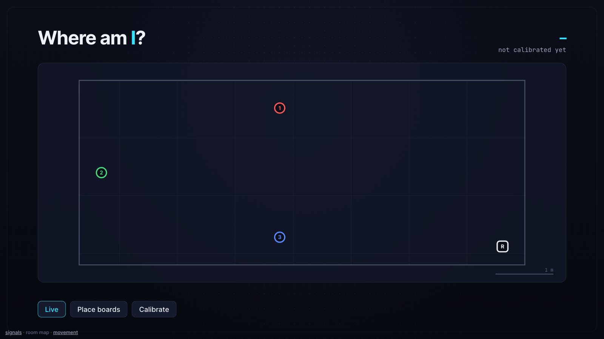

# wifi-sensing-kit

Teach three $10 ESP32-S3 boards to recognise what you're doing — sitting, squatting, spinning,
walking, jumping, standing, or nobody home — from your WiFi alone. Your webcam is the teacher
while you train; then you cover it and the WiFi keeps going.

Built on [RuView](https://github.com/ruvnet/RuView)'s open-source CSI firmware, with two changes:
each board lights up in its own colour, and the boards measure **each other** as well as the router,
so the room gets sensing links that cross it instead of all fanning out from the router.



## What to expect (measured, not marketing)

One person, one living room, three boards, one afternoon. Training: 3 rounds of 8 movements.
Test: a **separate** session recorded afterwards, judged by the camera:

| Movement | WiFi correct |   | Movement | WiFi correct |
|---|---|---|---|---|
| Nobody home | 100% | | Standing | 84% |
| Jumping | 97% | | Squatting | 79% |
| Sitting | 93% | | Walking | 70% |
| Spinning | 92% | | Waving | 13% (mostly read as jumping) |

**79.5% overall across 8 movements — guessing gets 12.5%.** Router links alone: 76.3%; only the
*amount* of motion: 63.1%. Your numbers will differ; `python kit/evaluate.py` gives you yours.

What it **doesn't** do: draw a skeleton, track your exact position (it can tell roughly which part of
a room you're in), or carry over to another room, another person, or boards that have been moved —
you retrain. See [docs/how-it-works.md](docs/how-it-works.md) for why.

## What you need

- **3 × ESP32-S3** dev boards with ≥ 8 MB flash (e.g. ESP32-S3-DevKitC-1 N16R8), USB **data** cables,
  and USB chargers to power them in place
- a **2.4 GHz WiFi** network (the boards can't join 5 GHz)
- a computer on that network with a **webcam** (macOS or Linux; Windows works for the dashboards)
- **ESP-IDF** v5.4 or v5.5 to build the firmware — [install guide](https://docs.espressif.com/projects/esp-idf/en/stable/esp32s3/get-started/)
- about an hour, and enough energy for ~10 minutes of squats

## Setup

```bash
git clone <this repo> && cd wifi-sensing-kit
python3 -m venv .venv && .venv/bin/python install.py      # Python packages + pose model (~28 MB)
cp config.example.yaml config.yaml                        # then edit it
```

1. **WiFi password** — save it alone in a text file (default `~/.wifi-sensing-pass`), `chmod 600` it.
   Put your network name in `config.yaml`.
2. **Find your boards** — plug all three in over USB (the board's *native* USB socket if it has two)
   and run `.venv/bin/python firmware/discover.py`. Paste the printed `boards:` list into `config.yaml`.
3. **Build** — `.venv/bin/python firmware/build.py` (downloads RuView v0.8.8, applies the patch, builds).
4. **Flash** — `.venv/bin/python firmware/flash.py`. Each board is flashed, joins your WiFi, and lights
   up in its colour.
5. **Router address** — `.venv/bin/python firmware/discover.py --router`, put it in `config.yaml`
   as `router_bssid`, then `firmware/build.py` and `firmware/flash.py --app-only` once more.
6. **Place the boards** around the room at chest height on chargers; nothing metal in between.
7. **Run** — `.venv/bin/python kit/server.py` and open <http://127.0.0.1:8932>.

## The three dashboards

| Page | What it shows |
|---|---|
| **Signals** (`/`) | Live CSI heatmap per board, packet rates, the board's own presence/motion detection |
| **Room map** (`/room.html`) | Your room (a floor plan from `config.yaml`, or a grid), every link lighting up as you cross it, and a calibrate-and-guess "which spot am I at" |
| **Movement** (`/movement.html`) | The webcam-taught movement model: train, test, cover the camera |

### Training the movement model

On the movement page (one tab only):

1. Frame the camera so it sees you **head to feet**, with a bit of floor below your feet.
   Check "Camera sees" follows a squat, a sit (facing the camera or at an angle) and a slow spin.
2. **Record training** — 3 rounds, ~9 minutes, prompts tell you what to do. Watch "saved: N windows"
   climb by ~2 per second. When it ends, the **Training check** shows what each movement got and lets
   you top up just the ones that are short.
3. **Record test** — one round, the honest score. Cover the camera any time to see WiFi alone.
4. `python kit/evaluate.py` — test accuracy, confusion table, which links matter.

For "Nobody", leave the room — out of the camera's view isn't enough; WiFi still feels you.

## Privacy

The webcam's video never leaves the browser: the pose model runs in the page, and only the movement
name ("squatting") is sent to the local server. Nothing leaves your computer. WiFi sensing works
through walls — only point it at spaces and people who know about it.

## Credits & licences

- Firmware: [RuView](https://github.com/ruvnet/RuView) `esp32-csi-node` v0.8.8, MIT — this kit ships a patch, not a fork.
- Pose model: Google [MediaPipe](https://developers.google.com/mediapipe) Pose Landmarker, Apache-2.0 (downloaded by `install.py`).
- Fonts: Inter and JetBrains Mono, SIL OFL 1.1.
- Everything else: MIT, see [LICENSE](LICENSE). Details in [NOTICE.md](NOTICE.md).

More: [how it works](docs/how-it-works.md) · [troubleshooting](docs/troubleshooting.md)
